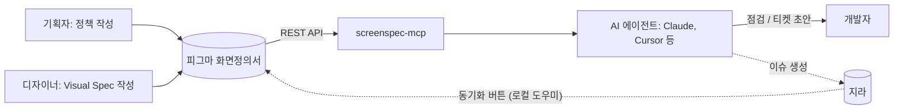

# screenspec-mcp

**피그마 화면정의서를 개발자와 AI 에이전트가 함께 보는 단일 기준으로 만들어요.**

[English](https://github.com/cherryeongyeo/screenspec-mcp/blob/main/README.md) · **한국어**

[](https://www.npmjs.com/package/screenspec-mcp)
[](https://github.com/cherryeongyeo/screenspec-mcp/actions/workflows/ci.yml)
[](LICENSE)

[](https://modelcontextprotocol.io)


`screenspec-mcp`는 피그마의 **화면정의서** 프레임을 읽는 [MCP](https://modelcontextprotocol.io) 서버예요. 정의서를 구조화된 데이터, 전달 전 점검(lint) 리포트, 지라 티켓 초안으로 바꿔줘요. 개발자가 피그마만 열어도 개발에 필요한 내용을 모두 볼 수 있게 하는 게 목표예요.

## 왜 만들었나요

대부분의 제품 팀에서 화면은 피그마에, 정책은 문서에, 작업은 지라에 흩어져 있어요. 개발자는 세 곳을 오가며 다시 읽고 정책을 티켓에 손으로 옮겨 적는데, 그러다 보면 내용이 서로 어긋나요.

이 프로젝트는 피그마 화면정의서를 내용을 적는 유일한 곳으로 만들어요.

- **기획자는 정책을 한 번만 써요.** 요소마다 기능, 콘텐츠, Interaction, State, Policy, Exception을 정의서에 적어요.
- **디자이너는 옆 칸에 Visual Spec을 채워요.** 디자인 토큰 기준으로 적어요.
- **개발자는 AI 에이전트에게 점검이나 티켓 초안을 요청해요.** 완료 조건은 기획자가 쓴 정책에서 바로 만들어져요.

## 이렇게 동작해요

> **나:** 장바구니 화면정의서, 개발 넘기기 전에 점검해줘.

```json
{
  "screenId": "C-02",
  "title": "장바구니 목록",
  "completeness": { "pm": 100, "design": 38 },
  "counts": { "error": 0, "warn": 2, "info": 0 },
  "issues": [
    { "level": "warn", "where": "C-02-1", "message": "Design 스펙 미작성: Interaction Visual, Responsive" },
    { "level": "warn", "where": "C-02-2", "message": "Design 스펙 미작성: Layout, Typography, Color, Component, State Visual, Interaction Visual, Responsive, Asset" }
  ]
}
```

> **나:** 1번 요소로 지라 티켓 초안 만들어줘.

```text
summary:  [C-02-1] 상품 리스트 구현
type:     작업
labels:   C-02          ← 나중에 Feedback Log가 이 티켓을 찾는 데 쓰여요
```

<details open>
<summary>생성된 본문 (Markdown, 일부 생략)</summary>

```markdown
> 화면: C-02 장바구니 목록 · 요소 1. 상품 리스트 (정의서 v1.2)

## 배경 / 목적
**화면 목적**: 사용자가 담아둔 상품을 확인하고 결제할 상품을 고른다
**기능**: 담은 상품을 판매자별로 묶어 보여주고, 결제할 상품을 선택한다

## 정책
**Policy**: 기본값은 전체 선택. 품절 상품은 선택할 수 없음. 최대 100개까지 담을 수 있음

## 완료 조건
- [ ] Default 상태가 정의대로 표시된다
- [ ] Loading 상태가 정의대로 표시된다
- [ ] Empty(담은 상품 없음) 상태가 정의대로 표시된다
- [ ] Error(불러오기 실패) 상태가 정의대로 표시된다
- [ ] 기본값은 전체 선택
- [ ] 품절 상품은 선택할 수 없음
- [ ] 최대 100개까지 담을 수 있음
- [ ] 가격이 바뀐 상품은 ‘가격 변동’ 배지와 이전 가격을 함께 표시
- [ ] 목록 API 실패 시 재시도 버튼 노출

## 디자인 참고
- Layout: 리스트 폭 FILL · 행 높이 112 · 좌우 padding spacing/6 20px
- Component: CartItem / State=Default, Soldout

## 열린 피드백
- DEMO-128 (검수요청) 품절 상품이 선택된 상태로 결제 금액에 포함됨

[Figma에서 보기](https://www.figma.com/design/…?node-id=1-…)
```

</details>

위 결과는 모두 템플릿의 샘플 정의서를 Figma API로 읽어서 만든 거예요. 이미 종료된 피드백(DEMO-119)은 자동으로 빠져요. 초안이 괜찮으면 실제 이슈로 만들어요.

> **나:** 에픽 DEMO-1 아래에 지라 이슈로 만들어줘.

```json
{
  "created": true,
  "issue": { "key": "DEMO-128", "url": "https://your-team.atlassian.net/browse/DEMO-128", "summary": "[C-02-1] 상품 리스트 구현" },
  "figma": { "linked": true, "name": "DEMO-128 · [C-02-1] 상품 리스트 구현" }
}
```

만들어진 이슈는 피그마 1번 요소에 **Dev Resource**로 붙어요. 개발자가 Dev Mode에서 요소를 선택하면 티켓이 바로 보여요. 같은 요소로 다시 요청하면 새로 만들지 않고 열려 있는 기존 이슈를 돌려줘요.

## 도구

| 도구 | 하는 일 |
|---|---|
| `list_screens` | 파일이나 섹션 안의 화면정의서를 모두 찾아요. 화면ID, 제목, 버전, 상태를 알려줘요 |
| `get_screen_spec` | 정의서 전체를 JSON으로 돌려줘요. 헤더, 개요, 요소별 PM/Design 항목, 피드백 로그, 변경 이력이 들어 있어요 |
| `get_element` | 뱃지 번호로 요소 하나를 가져와요. 관련 피드백, 연결된 지라 이슈, 시안에서 잘라낸 요소 이미지도 함께 줘요 |
| `lint_spec` | PM과 Design 작성률(%), 미작성 항목, 건너뛴 요소 번호, 버전 불일치, 상태 칩 문제, 요소 카드가 없는 시안 뱃지를 알려줘요 |
| `diff_spec` | 정의서를 피그마의 이전 버전(기본값: 마지막으로 이름 붙인 버전)과 비교해요. 요소별 바뀐 항목, 티켓에 영향을 줄 수 있는 정책 변경, Change Log에 넣을 문구를 알려줘요 |
| `draft_jira_ticket` | 요소의 PM 정책으로 티켓 초안을 만들어요. State, Policy, Exception이 완료 조건이 돼요 |
| `create_jira_ticket` | 초안을 지라 이슈로 만들고, 피그마 Dev Mode에서 요소에 연결해요. 같은 `[ref]`로 열린 이슈가 있으면 중복으로 만들지 않고 그 이슈를 돌려줘요 |
| `link_jira_issue` | 이미 있는 지라 이슈를 피그마 Dev Mode에서 요소에 연결해요 |
| `get_jira_feedback` | 화면의 지라 이슈를 Feedback Log 행으로 가져오고, 동기화하면 무엇이 바뀌는지 보여줘요. 새 이슈, 상태·담당자·댓글 변경, 지라에서 더 이상 안 나오는 행 |

`create_jira_ticket`과 `link_jira_issue`만 지라 이슈와 Dev Mode 링크를 만들고, 나머지는 모두 읽기 전용이에요. 점검 메시지와 티켓 초안은 정의서 언어(한국어/영어)를 따라가요.

## 시작하기

1. Figma 개인 액세스 토큰을 만들어요. 권한은 **File content: Read-only**가 필요해요. `diff_spec`을 쓰려면 **File versions: Read**를, Dev Mode에 티켓을 연결하려면 **Dev resources: Read and write**를 추가해요.
   지라는 id.atlassian.com → Security → API tokens에서 API 토큰을 만들어요.
2. MCP 클라이언트(Claude 데스크톱, Cursor 등)에 서버를 추가해요.

```json
{
  "mcpServers": {
    "screenspec": {
      "command": "npx",
      "args": ["-y", "screenspec-mcp"],
      "env": {
        "FIGMA_TOKEN": "figd_…",
        "JIRA_BASE_URL": "https://your-team.atlassian.net",
        "JIRA_EMAIL": "you@example.com",
        "JIRA_API_TOKEN": "…",
        "SCREENSPEC_CONFIG": "/path/to/screenspec.config.json"
      }
    }
  }
}
```

3. 피그마 링크를 붙이고 요청해요.

> https://www.figma.com/design/…?node-id=… 화면정의서 점검해줘
>
> C-02 1번 요소로 API 연동 지라 티켓 초안 만들어줘

**토큰이 아직 없다면** 함께 들어 있는 샘플로 먼저 써볼 수 있어요: `SCREENSPEC_FIXTURE=test/fixtures/sample-section.json npx screenspec-mcp`

## 지라로 Feedback Log 동기화하기

정의서의 Feedback Log는 피그마 플러그인 버튼으로 지라 내용을 가져와 채워요(지라 → 피그마 단방향). 지라는 피그마 안에서 보내는 요청을 받지 않아서, 내 컴퓨터에서 도는 작은 도우미가 대신 지라를 읽어줘요.

1. 도우미를 켜요. `JIRA_BASE_URL`, `JIRA_EMAIL`, `JIRA_API_TOKEN`을 환경 변수나 현재 폴더의 `.env`에서 읽어요.

   ```bash
   npx screenspec-mcp sync      # http://127.0.0.1:3917, 피그마 요청에만 응답해요
   ```
2. 피그마 데스크톱 앱에서 **Plugins → Development → Import plugin from manifest…**를 누르고 [`figma-plugin/manifest.json`](figma-plugin/manifest.json)을 골라요.
   맥에 로그인할 때마다 자동으로 켜지게 하려면 `.env`가 있는 폴더에서 `npx screenspec-mcp sync --install`을 한 번 실행해요(해제는 `--uninstall`).
3. 정의서가 있는 페이지에서 **Screen Spec Sync**를 실행하고 **동기화**를 눌러요. 정의서 하나만 선택하면 그것만 동기화해요.

화면ID 레이블이 붙었거나 제목이 `[C-02-1] …`로 시작하는 이슈가 한 행이 돼요. 요소, 유형, 이슈 키(링크), 에픽, 내용, 최근 댓글, 요청자 → 담당자, 상태, 반영 버전을 채워요. 있던 행은 그 자리에서 갱신하고, 지난 동기화 이후 댓글이 새로 달린 행은 댓글 칸에 빨간 **"새 댓글 N"** 표시가 붙어요(다음 동기화 때 사라져요).  새 이슈는 추가하고, 지라에서 더 이상 안 나오는 행은 지우지 않고 알려줘요. "최종 동기화" 시간도 바뀌어요.

## 피그마 양식

**한국어와 영어** 양식을 제공해요. 시안 영역이 있는 빈 양식, 채워진 샘플(C-02 장바구니 목록), 재사용 컴포넌트, 작성 가이드가 들어 있어요. 화면마다 섹션 하나를 쓰고, 섹션의 상태 모드에 따라 섹션 색이 바뀌어요.

<table>
<tr>
<td width="62%"></td>
<td valign="top">

<br><br>
<b>spec/badge</b>: 요소 번호. 시안과 요소 카드에 같이 써요.<br><br>
<b>spec/row</b>: 정의서 한 줄. <i>작성</i>을 미작성에서 완료로 바꾸면 글자가 검정이 돼요.<br><br>
<b>Status Chip</b>: 변수 컬렉션에 연결돼 있어요. 섹션의 <i>정의서 상태</i> 모드를 바꾸면(작성중 → 검토중 → 확정) 칩과 섹션 배경이 함께 바뀌어요.
</td>
</tr>
</table>

- **아무 피그마 파일에서나 만들 수 있어요.** `node scripts/render-template.mjs ko`(또는 `en`)를 실행하면 Figma Plugin API 스크립트가 나와요. 위치는 `'{"x":0,"y":0}'`처럼 넘기면 돼요. Figma MCP의 `use_figma` 도구나 플러그인 콘솔에서 실행하면 돼요. 무료 플랜에서는 상태 칩이 컴포넌트 variant 방식으로 자동 전환돼요.
- **다른 언어로 바꿀 수 있어요.** 문구는 [`figma-template/i18n.json`](figma-template/i18n.json)에 모여 있어요. 언어 블록을 하나 추가하면 돼요.

### 레이어 이름이 곧 약속이에요

파서는 화면 배치가 아니라 레이어 이름을 따라 읽어요. 그래서 이름만 유지하면 디자이너가 스타일을 자유롭게 바꿔도 돼요.

| 레이어 이름 | 의미 |
|---|---|
| `📄 <ID> <제목> · 화면정의서` / `· Screen Spec` | 화면정의서 문서 (표시 문구는 설정으로 바꿀 수 있어요) |
| `Doc Header` → `id` → `Status Chip`, `<ID>`, `v1.0` | 상태, 화면ID, 버전. 그 아래 제목과 한 줄 설명 |
| `화면 개요` / `Screen overview` → `개요 table` / `Overview table` → `spec/row` | 화면 개요 (화면 목적, 진입 경로, 화면 설명, 화면 흐름) |
| `요소 / <ID>-<n> <요소명>` / `Element / <ID>-<n> <name>` | 요소 카드. `n`은 시안의 뱃지 번호와 같아요 |
| `PM` / `Design` → `spec/row` | 항목. 행의 첫 텍스트가 항목명, 두 번째가 내용이에요. `작성=미작성` / `Filled=Empty`이면 미작성으로 봐요 |
| `feedback table` → `head`, `row / <지라 키>` → `cell / <열 이름>` | 지라에서 동기화한 피드백 로그. `last-synced`에 동기화 시간이 있어요 |
| `변경 이력` / `Change history` → `spec/changelog-row` | 변경 이력: 버전, 날짜, 역할, 작성자, 변경 내용 |
| `<ID> … · 시안` / `<ID> … · Mockup` (프레임) | 그 화면의 시안. 예: `C-02 장바구니 목록 · 시안` |
| 시안 위 `spec/badge` 인스턴스 | 번호 뱃지. **뱃지 중심을 요소의 왼쪽 위 모서리**에 놓으면 `get_element`가 그 요소를 잘라내요 |
| `area / <n>` (선택) | 요소 `n`의 정확한 영역(예: 투명 사각형). 뱃지 위치보다 우선해요 |

이전 양식으로 만든 정의서(`ITEM / n / 요소명`, `row / <항목>` 프레임, `chip / …`)도 그대로 읽어요.

`미작성`으로 표시돼 있거나 내용이 양식의 회색 가이드 문구 그대로면 **미작성**으로 봐요. `lint_spec`은 이 기준으로 작성률을 계산해요.

## 설정: 코어는 공개, 팀 설정은 비공개

팀마다 다른 값은 레포 밖의 JSON 파일에 둬요. `*.private.json`은 git에 올라가지 않아요.

```json
{
  "ticket": {
    "projectKey": "DEMO",
    "defaultIssueType": "작업",
    "summaryTemplate": "[{ref}] {itemName} {intent}",
    "labels": ["screenspec"]
  },
  "jira": { "parentKey": "DEMO-1", "dedupe": true },
  "figma": { "linkDevResources": true },
  "mockup": { "markers": ["시안", "Mockup"], "imageScale": 2, "padding": 16 },
  "feedback": { "doneStatuses": ["종료", "검수완료"] },
  "placeholders": ["미작성으로 볼 가이드 문구"]
}
```

[`examples/screenspec.config.example.json`](examples/screenspec.config.example.json)을 참고하세요.

## 동작 구조



## 로드맵

- [x] **v0.1**: 읽기 전용 파서, 도구 5개, 한국어/영어 양식, 오프라인 샘플 모드
- [x] **v0.2**: 시안 위 뱃지 컴포넌트로 요소별 시안 이미지 자르기, 버전 간 정의서 비교
- [x] **v0.3** *(먼저 완료)*: 지라 어댑터, Figma Dev Resources로 요소와 지라 이슈 연결 (Dev Mode에서 보임)
- [ ] **v0.4**: 지라 내용으로 Feedback Log를 갱신하는 피그마 플러그인 "동기화" 버튼 (지라 → 피그마 단방향)
- [ ] **v1.0**: 정의서가 바뀌면 지라 하위 작업 제안, Slack 알림

## 개발

```bash
npm install
npm run build
npm test                         # 파서, 점검, 티켓 테스트 (Node 22 이상)
node scripts/smoke.mjs           # 서버를 띄워 모든 도구를 호출해봐요
node scripts/live-test.mjs <url> # 실제 피그마 파일로 모든 도구를 실행해요 (.env에 FIGMA_TOKEN 필요)
node scripts/jira-live-test.mjs <url> <item> <project> # 실제 지라 이슈 1개를 만들고 Dev Mode에 연결해요
```

---

MIT © Chaeryeong Yeo
