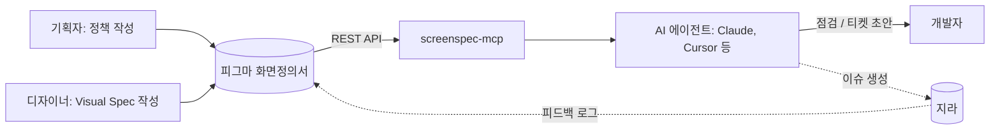

# screenspec-mcp

**피그마 화면정의서를 개발자와 AI 에이전트가 함께 보는 단일 기준으로 만들어요.**

[English](https://github.com/cherryeongyeo/screenspec-mcp/blob/main/README.md) · **한국어**

[](https://www.npmjs.com/package/screenspec-mcp)
[](https://github.com/cherryeongyeo/screenspec-mcp/actions/workflows/ci.yml)
[](LICENSE)

[](https://modelcontextprotocol.io)


`screenspec-mcp`는 피그마의 **화면정의서** 프레임을 읽는 [MCP](https://modelcontextprotocol.io) 서버예요. 정의서를 구조화된 데이터, 전달 전 점검(lint) 리포트, 지라 티켓 초안으로 바꿔줘요. 개발자가 피그마만 열어도 개발에 필요한 내용을 모두 볼 수 있게 하는 게 목표예요.

## 왜 만들었나요

대부분의 제품 팀에서 화면은 피그마에, 정책은 문서에, 작업은 지라에 흩어져 있어요. 개발자는 세 곳을 오가며 다시 읽고 정책을 티켓에 손으로 옮겨 적는데, 그러다 보면 내용이 서로 어긋나요.

이 프로젝트는 피그마 화면정의서를 내용을 적는 유일한 곳으로 만들어요.

- **기획자는 정책을 한 번만 써요.** 요소마다 기능, 콘텐츠, Interaction, State, Policy, Exception을 정의서에 적어요.
- **디자이너는 옆 칸에 Visual Spec을 채워요.** 디자인 토큰 기준으로 적어요.
- **개발자는 AI 에이전트에게 점검이나 티켓 초안을 요청해요.** 완료 조건은 기획자가 쓴 정책에서 바로 만들어져요.

## 이렇게 동작해요

> **나:** 장바구니 화면정의서, 개발 넘기기 전에 점검해줘.

```json
{
  "screenId": "C-02",
  "title": "장바구니 목록",
  "completeness": { "pm": 100, "design": 38 },
  "counts": { "error": 0, "warn": 2, "info": 0 },
  "issues": [
    { "level": "warn", "where": "C-02-1", "message": "Design 스펙 미작성: Interaction Visual, Responsive" },
    { "level": "warn", "where": "C-02-2", "message": "Design 스펙 미작성: Layout, Typography, Color, Component, State Visual, Interaction Visual, Responsive, Asset" }
  ]
}
```

> **나:** 1번 요소로 지라 티켓 초안 만들어줘.

```text
summary:  [C-02-1] 상품 리스트 구현
type:     작업
labels:   C-02          ← 나중에 Feedback Log가 이 티켓을 찾는 데 쓰여요
```

<details open>
<summary>생성된 본문 (Markdown, 일부 생략)</summary>

```markdown
> 화면: C-02 장바구니 목록 · 요소 1. 상품 리스트 (정의서 v1.2)

## 배경 / 목적
**화면 목적**: 사용자가 담아둔 상품을 확인하고 결제할 상품을 고른다
**기능**: 담은 상품을 판매자별로 묶어 보여주고, 결제할 상품을 선택한다

## 정책
**Policy**: 기본값은 전체 선택. 품절 상품은 선택할 수 없음. 최대 100개까지 담을 수 있음

## 완료 조건
- [ ] Default 상태가 정의대로 표시된다
- [ ] Loading 상태가 정의대로 표시된다
- [ ] Empty(담은 상품 없음) 상태가 정의대로 표시된다
- [ ] Error(불러오기 실패) 상태가 정의대로 표시된다
- [ ] 기본값은 전체 선택
- [ ] 품절 상품은 선택할 수 없음
- [ ] 최대 100개까지 담을 수 있음
- [ ] 가격이 바뀐 상품은 ‘가격 변동’ 배지와 이전 가격을 함께 표시
- [ ] 목록 API 실패 시 재시도 버튼 노출

## 디자인 참고
- Layout: 리스트 폭 FILL · 행 높이 112 · 좌우 padding spacing/6 20px
- Component: CartItem / State=Default, Soldout

## 열린 피드백
- DEMO-128 (검수요청) 품절 상품이 선택된 상태로 결제 금액에 포함됨

[Figma에서 보기](https://www.figma.com/design/…?node-id=1-…)
```

</details>

위 결과는 모두 템플릿의 샘플 정의서를 Figma API로 읽어서 만든 거예요. 이미 종료된 피드백(DEMO-119)은 자동으로 빠져요. 티켓은 초안까지만 만들어요. 같은 대화에서 지라 MCP(예: Atlassian)에 넘기면 바로 이슈로 만들 수 있어요.

## 도구

| 도구 | 하는 일 |
|---|---|
| `list_screens` | 파일이나 섹션 안의 화면정의서를 모두 찾아요. 화면ID, 제목, 버전, 상태를 알려줘요 |
| `get_screen_spec` | 정의서 전체를 JSON으로 돌려줘요. 헤더, 개요, 요소별 PM/Design 항목, 피드백 로그, 변경 이력이 들어 있어요 |
| `get_element` | 뱃지 번호로 요소 하나를 가져와요. 관련 피드백과 요소 카드 이미지도 함께 줘요 |
| `lint_spec` | PM과 Design 작성률(%), 미작성 항목, 건너뛴 요소 번호, 버전 불일치, 상태 칩 문제를 알려줘요 |
| `draft_jira_ticket` | 요소의 PM 정책으로 티켓 초안을 만들어요. State, Policy, Exception이 완료 조건이 돼요 |

모든 도구는 읽기 전용이에요. 점검 메시지와 티켓 초안은 정의서 언어(한국어/영어)를 따라가요.

## 시작하기

1. Figma 개인 액세스 토큰을 만들어요. 권한은 **File content: Read-only**만 있으면 돼요.
2. MCP 클라이언트(Claude 데스크톱, Cursor 등)에 서버를 추가해요.

```json
{
  "mcpServers": {
    "screenspec": {
      "command": "npx",
      "args": ["-y", "screenspec-mcp"],
      "env": {
        "FIGMA_TOKEN": "figd_…",
        "SCREENSPEC_CONFIG": "/path/to/screenspec.config.json"
      }
    }
  }
}
```

3. 피그마 링크를 붙이고 요청해요.

> https://www.figma.com/design/…?node-id=… 화면정의서 점검해줘
>
> C-02 1번 요소로 API 연동 지라 티켓 초안 만들어줘

**토큰이 아직 없다면** 함께 들어 있는 샘플로 먼저 써볼 수 있어요: `SCREENSPEC_FIXTURE=test/fixtures/sample-section.json npx screenspec-mcp`

## 피그마 양식

**한국어와 영어** 양식을 제공해요. 빈 양식, 채워진 샘플, 재사용 컴포넌트가 들어 있어요.

<table>
<tr>
<td width="62%"></td>
<td valign="top">

<br><br>
<b>번호 뱃지</b>: 시안과 정의서의 요소 번호를 맞춰요.<br><br>
<b>정의서 상태 (자동)</b>: 변수 컬렉션에 연결돼 있어요. 프레임의 <i>정의서 상태</i> 모드를 바꾸면(작성중 → 검토중 → 확정) 칩의 라벨과 색이 자동으로 바뀌어요.
</td>
</tr>
</table>

- **아무 피그마 파일에서나 만들 수 있어요.** `node scripts/render-template.mjs ko`(또는 `en`)를 실행하면 Figma Plugin API 스크립트가 나와요. Figma MCP의 `use_figma` 도구나 플러그인 콘솔에서 실행하면 돼요. 무료 플랜에서는 상태 칩이 컴포넌트 variant 방식으로 자동 전환돼요.
- **다른 언어로 바꿀 수 있어요.** 문구는 [`figma-template/i18n.json`](figma-template/i18n.json)에 모여 있어요. 언어 블록을 하나 추가하면 돼요.

### 레이어 이름이 곧 약속이에요

파서는 화면 배치가 아니라 레이어 이름을 따라 읽어요. 그래서 이름만 유지하면 디자이너가 스타일을 자유롭게 바꿔도 돼요.

| 레이어 이름 | 의미 |
|---|---|
| `📄 <ID> <제목> · 화면정의서` / `· Screen Spec` | 화면정의서 문서 (표시 문구는 설정으로 바꿀 수 있어요) |
| `Doc Header` → `chip / [화면ID]`, `chip / v1.0`, 인스턴스 `상태` / `Status` | 화면ID, 버전, 상태 |
| `개요` / `Overview` → `row / <항목>` | 화면 개요 (화면 목적, 진입 경로) |
| `ITEM / <n> / <요소명>` | 요소 카드. `n`은 시안의 뱃지 번호와 같아요 |
| `PM column` / `Design column` → `row / <항목>` | 항목. 첫 텍스트가 항목명, 나머지가 내용이에요 |
| `feedback table` → `head`, `row / <지라 키>` → `cell n` | 지라에서 동기화한 피드백 로그 |
| `변경 이력` / `Change history` → `row` | 변경 이력: 버전, 날짜, 역할, 작성자, 변경 내용 |

내용이 양식의 회색 가이드 문구와 같으면 **미작성**으로 봐요. `lint_spec`은 이 기준으로 작성률을 계산해요.

## 설정: 코어는 공개, 팀 설정은 비공개

팀마다 다른 값은 레포 밖의 JSON 파일에 둬요. `*.private.json`은 git에 올라가지 않아요.

```json
{
  "ticket": {
    "projectKey": "DEMO",
    "defaultIssueType": "작업",
    "summaryTemplate": "[{ref}] {itemName} {intent}",
    "labels": ["screenspec"]
  },
  "feedback": { "doneStatuses": ["종료", "검수완료"] },
  "placeholders": ["미작성으로 볼 가이드 문구"]
}
```

[`examples/screenspec.config.example.json`](examples/screenspec.config.example.json)을 참고하세요.

## 동작 구조



## 로드맵

- [x] **v0.1**: 읽기 전용 파서, 도구 5개, 한국어/영어 양식, 오프라인 샘플 모드
- [ ] **v0.2**: 시안 위 뱃지 컴포넌트로 요소별 시안 이미지 자르기, 버전 간 정의서 비교
- [ ] **v0.3**: 지라 어댑터, Figma Dev Resources로 요소와 지라 이슈 연결 (Dev Mode에서 보임)
- [ ] **v0.4**: 지라 내용으로 Feedback Log를 갱신하는 피그마 플러그인 "동기화" 버튼 (지라 → 피그마 단방향)
- [ ] **v1.0**: 정의서가 바뀌면 지라 하위 작업 제안, Slack 알림

## 개발

```bash
npm install
npm run build
npm test                         # 파서, 점검, 티켓 테스트 (Node 22 이상)
node scripts/smoke.mjs           # 서버를 띄워 모든 도구를 호출해봐요
node scripts/live-test.mjs <url> # 실제 피그마 파일로 모든 도구를 실행해요 (.env에 FIGMA_TOKEN 필요)
```

---

MIT © Chaeryeong Yeo
