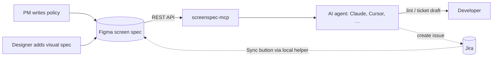

# screenspec-mcp

**Turn Figma screen specs into the single source of truth for developers and their AI agents.**

**English** · [한국어](https://github.com/cherryeongyeo/screenspec-mcp/blob/main/README.ko.md)

[](https://www.npmjs.com/package/screenspec-mcp)
[](https://github.com/cherryeongyeo/screenspec-mcp/actions/workflows/ci.yml)
[](LICENSE)

[](https://modelcontextprotocol.io)


`screenspec-mcp` is an [MCP](https://modelcontextprotocol.io) server that reads **screen spec** (화면정의서) frames in Figma. It turns them into structured specs, hand-off lint reports and Jira ticket drafts, so a developer can open Figma and have everything they need to build.

## Why

On most product teams the screen spec lives in Figma, the policy lives in a doc, and the tickets live in Jira. Developers re-read all three and copy policy into tickets by hand, and the copies drift.

This project makes the Figma spec the one place to write things down:

- **The PM writes policy once**, per element, in the spec: function, content, interaction, states, rules, edge cases.
- **The designer adds the visual spec** next to it, using design tokens.
- **The developer asks their agent** for a lint check or a ticket draft. Acceptance criteria come straight from the PM's policy.

## What it looks like

> **You:** Lint the cart screen spec before hand-off.

```json
{
  "screenId": "C-02",
  "title": "Cart list",
  "completeness": { "pm": 100, "design": 38 },
  "counts": { "error": 0, "warn": 2, "info": 0 },
  "issues": [
    { "level": "warn", "where": "C-02-1", "message": "Design spec missing: Interaction Visual, Responsive" },
    { "level": "warn", "where": "C-02-2", "message": "Design spec missing: Layout, Typography, Color, Component, State Visual, Interaction Visual, Responsive, Asset" }
  ]
}
```

> **You:** Draft a Jira ticket for element 1.

```text
summary:  [C-02-1] Item list implementation
type:     Task
labels:   C-02          ← lets the Feedback Log find this ticket later
```

<details open>
<summary>Generated description (Markdown, abridged)</summary>

```markdown
> Screen: C-02 Cart list · Element 1. Item list (spec v1.2)

## Background
**Purpose**: The user reviews saved items and picks what to pay for
**Function**: Shows cart items grouped by seller and lets the user pick what to check out

## Policy
**Policy**: All items are selected by default. Sold-out items can't be selected. Up to 100 items

## Acceptance criteria
- [ ] Default state is shown as specified
- [ ] Loading state is shown as specified
- [ ] Empty (cart is empty) state is shown as specified
- [ ] Error (failed to load) state is shown as specified
- [ ] All items are selected by default
- [ ] Sold-out items can't be selected
- [ ] Up to 100 items
- [ ] If a price changed, show a ‘Price changed’ badge with the old price
- [ ] If the list API fails, show a retry button

## Design reference
- Layout: List width FILL · row height 112 · horizontal padding spacing/6 20px
- Component: CartItem / State=Default, Soldout

## Open feedback
- DEMO-128 (Review Requested) Sold-out items stay selected and are added to the total

[Open in Figma](https://www.figma.com/design/…?node-id=1-302)
```

</details>

Both outputs above come from the sample spec in the template, read through the Figma API. Closed feedback (DEMO-119) is left out automatically. Happy with the draft? Create it for real:

> **You:** Create it in Jira under epic DEMO-1.

```json
{
  "created": true,
  "issue": { "key": "DEMO-128", "url": "https://your-team.atlassian.net/browse/DEMO-128", "summary": "[C-02-1] Item list implementation" },
  "figma": { "linked": true, "name": "DEMO-128 · [C-02-1] Item list implementation" }
}
```

The issue is attached to element 1 in Figma as a **Dev Resource**, so a developer inspecting the element in Dev Mode sees the ticket right there. Ask again for the same element and you get the existing open issue back instead of a duplicate.

## Tools

| Tool | What it does |
|---|---|
| `list_screens` | Finds every screen spec in a file or section, with ID, title, version and status |
| `get_screen_spec` | Returns the full spec as JSON: header, overview, elements (PM + Design fields), feedback log, change log |
| `get_element` | Returns one element by its badge number, with related feedback, linked Jira issues and a crop of that element from the mockup |
| `lint_spec` | Reports completeness % for PM and Design, unfilled fields, skipped element numbers, version drift, status chip issues and mockup badges with no element card |
| `diff_spec` | Compares a spec with an earlier Figma version (the last named version by default): changed fields per element, policy changes that may affect tickets, and a suggested Change Log row |
| `draft_jira_ticket` | Drafts a ticket from an element's PM policy. State, Policy and Exception become acceptance criteria |
| `create_jira_ticket` | Creates the drafted ticket in Jira and links it to the element in Figma Dev Mode. Reuses an open issue with the same `[ref]` instead of duplicating it |
| `link_jira_issue` | Links an existing Jira issue to an element in Figma Dev Mode |
| `get_jira_feedback` | Fetches the screen's Jira issues as Feedback Log rows and shows what a Sync would change: new issues, changed status/assignee/comment, rows Jira no longer returns |

Only `create_jira_ticket` and `link_jira_issue` write anything: a Jira issue and a Dev Mode link. Everything else is read-only. Lint messages and ticket drafts follow the spec's language (Korean or English).

## Quick start

1. Create a Figma personal access token with **File content: Read-only**. For `diff_spec`, add **File versions: Read**. To link tickets in Dev Mode, add **Dev resources: Read and write**.
   For Jira, create an API token at id.atlassian.com → Security → API tokens.
2. Add the server to your MCP client (Claude Desktop, Cursor, …):

```json
{
  "mcpServers": {
    "screenspec": {
      "command": "npx",
      "args": ["-y", "screenspec-mcp"],
      "env": {
        "FIGMA_TOKEN": "figd_…",
        "JIRA_BASE_URL": "https://your-team.atlassian.net",
        "JIRA_EMAIL": "you@example.com",
        "JIRA_API_TOKEN": "…",
        "SCREENSPEC_CONFIG": "/path/to/screenspec.config.json"
      }
    }
  }
}
```

3. Paste a Figma link and ask:

> Lint the screen spec at https://www.figma.com/design/…?node-id=…
>
> Draft a Jira ticket for element 1 of C-02, for API integration.

**No token yet?** Try it on the bundled sample: `SCREENSPEC_FIXTURE=test/fixtures/sample-section.json npx screenspec-mcp`.

## Sync the Feedback Log from Jira

The Feedback Log in each spec is filled from Jira by a Figma plugin button (Jira → Figma, one way). Jira doesn't accept requests from inside Figma, so a small helper on your computer reads Jira for the plugin.

1. Start the helper. It reads `JIRA_BASE_URL`, `JIRA_EMAIL` and `JIRA_API_TOKEN` from the environment or a `.env` file in the current folder:

   ```bash
   npx screenspec-mcp sync      # http://127.0.0.1:3917, only answers Figma
   ```
2. In the Figma desktop app: **Plugins → Development → Import plugin from manifest…** and pick [`figma-plugin/manifest.json`](figma-plugin/manifest.json).
   To start it automatically at every login (macOS), run this once in the folder with your `.env`: `npx screenspec-mcp sync --install` (remove with `--uninstall`).
3. Open the page with your specs, run **Screen Spec Sync** and press **Sync**. Select a spec first to sync just that one.

Each issue labelled with the screen ID (or summarised `[C-02-1] …`) becomes a row: element, type, key with link, epic, summary, latest comment, reporter → assignee, status and fix version. Rows are updated in place, and a row whose issue got comments since the last sync is marked **"N new"** in red on its comment line until the next sync. New issues are added, and rows Jira no longer returns are left alone and reported. The "Last synced" line is updated.

## The Figma template

A ready-made template in **Korean and English**: a blank spec with a mockup area, a filled sample (C-02 Cart list), reusable components and a writing guide. Each screen lives in its own section, and the section's status mode colors it.

<table>
<tr>
<td width="62%"></td>
<td valign="top">

<br><br>
<b>spec/badge</b>: the element number, on the mockup and on the element card.<br><br>
<b>spec/row</b>: one spec line. Switch <i>Filled</i> from Empty to Done and the text turns black.<br><br>
<b>Status Chip</b>: bound to a variable collection. Change the <i>Spec Status</i> mode on the section (Draft → In review → Final) and the chip and section background follow.
</td>
</tr>
</table>

- **Generate it in any Figma file:** `node scripts/render-template.mjs en` (or `ko`) prints a Figma Plugin API script; pass `'{"x":0,"y":0}'` to choose where it goes. Run it with the Figma MCP `use_figma` tool or a plugin console. On a free Figma plan, the status chip falls back to component variants.
- **Localize it:** copy and wording live in [`figma-template/i18n.json`](figma-template/i18n.json). Add a language block to add a language.

<details>
<summary>Korean version</summary>


</details>

### Layer names are the contract

The parser follows layer names, not visual layout, so designers can restyle freely as long as the names stay.

| Layer name | Meaning |
|---|---|
| `📄 <ID> <title> · 화면정의서` / `· Screen Spec` | A screen spec document (markers configurable) |
| `Doc Header` → `id` → `Status Chip`, `<ID>`, `v1.0` | Status, screen ID and version; then the title and one-line summary |
| `화면 개요` / `Screen overview` → `개요 table` / `Overview table` → `spec/row` | Screen overview lines (purpose, entry point, description, flow) |
| `요소 / <ID>-<n> <name>` / `Element / <ID>-<n> <name>` | One element card. `n` matches the badge on the mockup |
| `PM` / `Design` → `spec/row` | Fields. Each row's first text is the label, the second the value. Variant `작성=미작성` / `Filled=Empty` counts as unfilled |
| `feedback table` → `head`, `row / <JIRA-KEY>` → `cell / <column>` | Feedback log synced from Jira; `last-synced` holds the sync time |
| `변경 이력` / `Change history` → `spec/changelog-row` | Change log: version, date, role, author, change |
| `<ID> … · 시안` / `<ID> … · Mockup` (frame) | The mockup for that screen, e.g. `C-02 Cart list · Mockup` |
| `spec/badge` (instance) on the mockup | Number badge. Put its **center on the element's top-left corner** and `get_element` crops that element |
| `area / <n>` (optional) | Exact region for element `n`, e.g. a transparent rectangle. Wins over the badge position |

Older specs built with the previous template (`ITEM / n / name`, `row / <label>` frames, `chip / …`) are still read.

Rows still marked unfilled, or still showing the template's guide text, count as **unfilled**. That's how `lint_spec` measures completeness.

## Configuration: public core, private settings

Everything team-specific lives in a JSON file outside the repo (`*.private.json` is git-ignored):

```json
{
  "ticket": {
    "projectKey": "DEMO",
    "defaultIssueType": "Task",
    "summaryTemplate": "[{ref}] {itemName} {intent}",
    "labels": ["screenspec"]
  },
  "jira": { "parentKey": "DEMO-1", "dedupe": true },
  "figma": { "linkDevResources": true },
  "mockup": { "markers": ["Mockup", "시안"], "imageScale": 2, "padding": 16 },
  "feedback": { "doneStatuses": ["Done", "Closed"] },
  "placeholders": ["extra guide text to treat as empty"]
}
```

See [`examples/screenspec.config.example.json`](examples/screenspec.config.example.json).

## How it works



## Roadmap

- [x] **v0.1**: read-only parser, 5 tools, KOR/ENG template, offline fixture mode
- [x] **v0.2**: element crop images from the number badges on the mockup; spec diff between versions
- [x] **v0.3** *(shipped early)*: Jira adapter; link Jira issues to elements via Figma Dev Resources (visible in Dev Mode)
- [ ] **v0.4**: Figma plugin "Sync" button that refreshes the Feedback Log from Jira (Jira → Figma, one way)
- [ ] **v1.0**: spec change → Jira sub-task suggestions, Slack notifications

## Development

```bash
npm install
npm run build
npm test                         # parser, lint and ticket tests (Node 22+)
node scripts/smoke.mjs           # spawns the server over stdio and calls every tool
node scripts/live-test.mjs <url> # runs every tool against a real Figma file (FIGMA_TOKEN in .env)
node scripts/jira-live-test.mjs <url> <item> <project> # creates ONE real Jira issue and links it in Dev Mode
```

---

MIT © Chaeryeong Yeo
