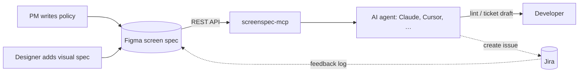

# screenspec-mcp

**Turn Figma screen specs into the single source of truth for developers and their AI agents.**

**English** · [한국어](https://github.com/cherryeongyeo/screenspec-mcp/blob/main/README.ko.md)

[](https://www.npmjs.com/package/screenspec-mcp)
[](https://github.com/cherryeongyeo/screenspec-mcp/actions/workflows/ci.yml)
[](LICENSE)

[](https://modelcontextprotocol.io)


`screenspec-mcp` is an [MCP](https://modelcontextprotocol.io) server that reads **screen spec** (화면정의서) frames in Figma. It turns them into structured specs, hand-off lint reports and Jira ticket drafts, so a developer can open Figma and have everything they need to build.

## Why

On most product teams the screen spec lives in Figma, the policy lives in a doc, and the tickets live in Jira. Developers re-read all three and copy policy into tickets by hand, and the copies drift.

This project makes the Figma spec the one place to write things down:

- **The PM writes policy once**, per element, in the spec: function, content, interaction, states, rules, edge cases.
- **The designer adds the visual spec** next to it, using design tokens.
- **The developer asks their agent** for a lint check or a ticket draft. Acceptance criteria come straight from the PM's policy.

## What it looks like

> **You:** Lint the cart screen spec before hand-off.

```json
{
  "screenId": "C-02",
  "title": "Cart list",
  "completeness": { "pm": 100, "design": 38 },
  "counts": { "error": 0, "warn": 2, "info": 0 },
  "issues": [
    { "level": "warn", "where": "C-02-1", "message": "Design spec missing: Interaction Visual, Responsive" },
    { "level": "warn", "where": "C-02-2", "message": "Design spec missing: Layout, Typography, Color, Component, State Visual, Interaction Visual, Responsive, Asset" }
  ]
}
```

> **You:** Draft a Jira ticket for element 1.

```text
summary:  [C-02-1] Item list implementation
type:     Task
labels:   C-02          ← lets the Feedback Log find this ticket later
```

<details open>
<summary>Generated description (Markdown, abridged)</summary>

```markdown
> Screen: C-02 Cart list · Element 1. Item list (spec v1.2)

## Background
**Purpose**: The user reviews saved items and picks what to pay for
**Function**: Shows cart items grouped by seller and lets the user pick what to check out

## Policy
**Policy**: All items are selected by default. Sold-out items can't be selected. Up to 100 items

## Acceptance criteria
- [ ] Default state is shown as specified
- [ ] Loading state is shown as specified
- [ ] Empty (cart is empty) state is shown as specified
- [ ] Error (failed to load) state is shown as specified
- [ ] All items are selected by default
- [ ] Sold-out items can't be selected
- [ ] Up to 100 items
- [ ] If a price changed, show a ‘Price changed’ badge with the old price
- [ ] If the list API fails, show a retry button

## Design reference
- Layout: List width FILL · row height 112 · horizontal padding spacing/6 20px
- Component: CartItem / State=Default, Soldout

## Open feedback
- DEMO-128 (Review Requested) Sold-out items stay selected and are added to the total

[Open in Figma](https://www.figma.com/design/…?node-id=1-302)
```

</details>

Both outputs above come from the sample spec in the template, read through the Figma API. Closed feedback (DEMO-119) is left out automatically. The ticket is only a draft. Hand it to a Jira MCP (e.g. Atlassian's) in the same conversation to create the issue.

## Tools

| Tool | What it does |
|---|---|
| `list_screens` | Finds every screen spec in a file or section, with ID, title, version and status |
| `get_screen_spec` | Returns the full spec as JSON: header, overview, elements (PM + Design fields), feedback log, change log |
| `get_element` | Returns one element by its badge number, with related feedback and a rendered image of the element card |
| `lint_spec` | Reports completeness % for PM and Design, unfilled fields, skipped element numbers, version drift and status chip issues |
| `draft_jira_ticket` | Drafts a ticket from an element's PM policy. State, Policy and Exception become acceptance criteria |

All tools are read-only. Lint messages and ticket drafts follow the spec's language (Korean or English).

## Quick start

1. Create a Figma personal access token with **File content: Read-only** scope.
2. Add the server to your MCP client (Claude Desktop, Cursor, …):

```json
{
  "mcpServers": {
    "screenspec": {
      "command": "npx",
      "args": ["-y", "screenspec-mcp"],
      "env": {
        "FIGMA_TOKEN": "figd_…",
        "SCREENSPEC_CONFIG": "/path/to/screenspec.config.json"
      }
    }
  }
}
```

3. Paste a Figma link and ask:

> Lint the screen spec at https://www.figma.com/design/…?node-id=…
>
> Draft a Jira ticket for element 1 of C-02, for API integration.

**No token yet?** Try it on the bundled sample: `SCREENSPEC_FIXTURE=test/fixtures/sample-section.json npx screenspec-mcp`.

## The Figma template

A ready-made template in **Korean and English**, with a blank spec, a filled sample and reusable components.

<table>
<tr>
<td width="62%"></td>
<td valign="top">

<br><br>
<b>Number badge</b>: matches the element number on the mockup and in the spec.<br><br>
<b>Spec status (auto)</b>: bound to a variable collection. Change the <i>Spec Status</i> mode on a frame (Draft → In review → Final) and the chip's label and colors follow.
</td>
</tr>
</table>

- **Generate it in any Figma file:** `node scripts/render-template.mjs en` (or `ko`) prints a Figma Plugin API script. Run it with the Figma MCP `use_figma` tool or a plugin console. On a free Figma plan, the status chip falls back to component variants.
- **Localize it:** copy and wording live in [`figma-template/i18n.json`](figma-template/i18n.json). Add a language block to add a language.

<details>
<summary>Korean version</summary>


</details>

### Layer names are the contract

The parser follows layer names, not visual layout, so designers can restyle freely as long as the names stay.

| Layer name | Meaning |
|---|---|
| `📄 <ID> <title> · 화면정의서` / `· Screen Spec` | A screen spec document (markers configurable) |
| `Doc Header` → `chip / [화면ID]`, `chip / v1.0`, instance `상태` / `Status` | Screen ID, version, status |
| `개요` / `Overview` → `row / <label>` | Screen overview rows (purpose, entry point) |
| `ITEM / <n> / <name>` | One element card. `n` matches the badge on the mockup |
| `PM column` / `Design column` → `row / <label>` | Fields. The first text is the label, the rest is the value |
| `feedback table` → `head`, `row / <JIRA-KEY>` → `cell n` | Feedback log synced from Jira |
| `변경 이력` / `Change history` → `row` | Change log: version, date, role, author, change |

Values still equal to the template's guide text count as **unfilled**. That's how `lint_spec` measures completeness.

## Configuration: public core, private settings

Everything team-specific lives in a JSON file outside the repo (`*.private.json` is git-ignored):

```json
{
  "ticket": {
    "projectKey": "DEMO",
    "defaultIssueType": "Task",
    "summaryTemplate": "[{ref}] {itemName} {intent}",
    "labels": ["screenspec"]
  },
  "feedback": { "doneStatuses": ["Done", "Closed"] },
  "placeholders": ["extra guide text to treat as empty"]
}
```

See [`examples/screenspec.config.example.json`](examples/screenspec.config.example.json).

## How it works



## Roadmap

- [x] **v0.1**: read-only parser, 5 tools, KOR/ENG template, offline fixture mode
- [ ] **v0.2**: badge component on the mockup → element crop images; spec diff between versions
- [ ] **v0.3**: Jira adapter; link Jira issues to element nodes via Figma Dev Resources (visible in Dev Mode)
- [ ] **v0.4**: Figma plugin "Sync" button that refreshes the Feedback Log from Jira (Jira → Figma, one way)
- [ ] **v1.0**: spec change → Jira sub-task suggestions, Slack notifications

## Development

```bash
npm install
npm run build
npm test                         # parser, lint and ticket tests (Node 22+)
node scripts/smoke.mjs           # spawns the server over stdio and calls every tool
node scripts/live-test.mjs <url> # runs every tool against a real Figma file (FIGMA_TOKEN in .env)
```

---

MIT © Chaeryeong Yeo
